<p align="center">
  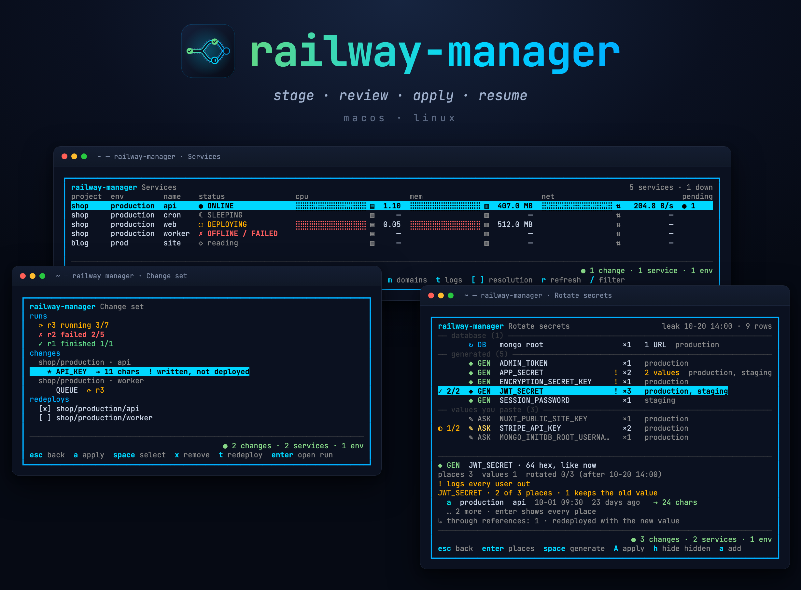
</p>

# railway-manager

A terminal app for the variables, secrets, database passwords, limits, domains,
restarts and logs of all your Railway projects and environments. Every edit goes
into one local change set, and nothing reaches Railway until you review it and
apply it.

## Install

```bash
go install github.com/men232/railway-manager/cmd/railway-manager@latest
```

`go install` puts the binary in `$(go env GOPATH)/bin`, usually `~/go/bin`.
If your shell says `railway-manager: command not found`, add that directory to
your `PATH`, for zsh:

```bash
echo 'export PATH="$(go env GOPATH)/bin:$PATH"' >> ~/.zshrc && source ~/.zshrc
```

You need:

- macOS or Linux.
- Go 1.27 or newer. The module asks for the go1.27.3 toolchain, and `go`
  downloads it by itself if yours is older.
- The [Railway CLI](https://docs.railway.com/guides/cli), signed in with `railway login`.
- To change database passwords: `ssh`, and `mongosh`, `psql` or `redis-cli` for
  the database. The app tells you which one is missing and how to install it.

To build from source:

```bash
git clone https://github.com/men232/railway-manager && cd railway-manager
make build        # ./railway-manager, with the version stamped in
```

## Run

```bash
railway-manager                                   # the projects picked in Settings
railway-manager --project shop --env production   # only these, for this run
railway-manager --project shop,blog --env staging,production
```

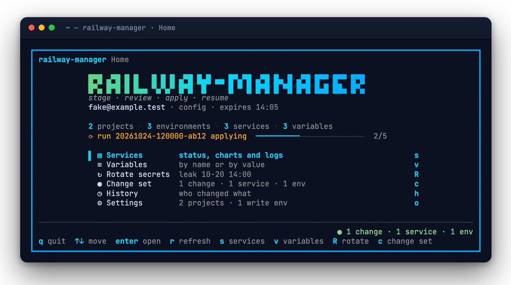

The token comes from `RAILWAY_API_TOKEN`, then `RAILWAY_TOKEN`, then the Railway
CLI's `~/.railway/config.json`. The CLI's token lasts an hour and the app
refreshes it. If the refresh fails, it asks you to run `railway login` in
another terminal.

In Settings (`o` from Home) you pick the projects to read, the environments the
app may write to, the leak time and your own internal secret names. Nothing is
writable until you add an environment there.

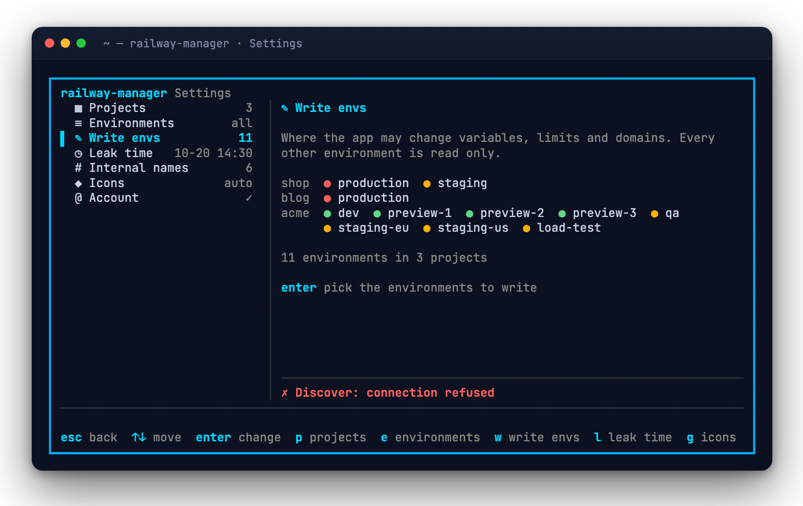

The first database password change on a machine stops before it touches
anything and shows the fingerprint of Railway's SSH host key. Compare it with
the one Railway publishes, press `t` on the Run screen, type `trust`, then `r`
to continue.

## What it does

### One change set for every screen

Editing a variable, adding a domain, raising a memory limit or rotating a token
sends nothing yet. The change goes into the change set, and every screen shows
Railway's current value next to the one you staged.

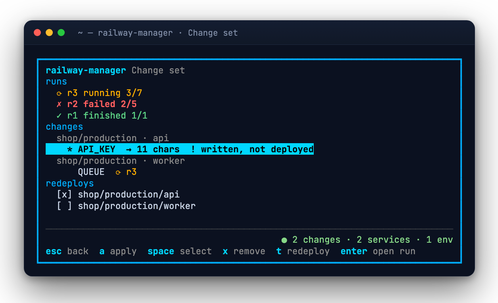

The Change set screen groups the diff by environment and service and lists the
redeploys it implies, each of which you can switch off. You can apply all of it
or only what you selected. If someone changed a value in Railway after you
staged yours, the change is marked as drifted and is not written over theirs.

### Runs that resume

Apply turns the change set into a graph of small steps that are safe to repeat.
A database password is changed before the variables that hold it, variables
are written before the redeploys that pick them up, and a service is never
redeployed with half of a change.

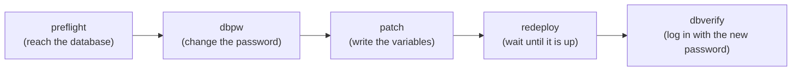

Each step's status is written to disk. If the laptop sleeps, the network drops
or a deploy fails, run it again: it continues from the first unfinished step
and checks Railway before each action, so nothing is written twice.

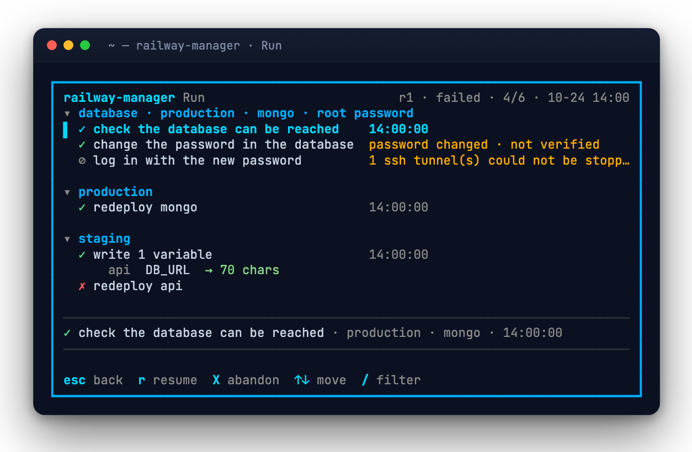

A run that stopped during a password change stays on Home and in the change set
until you continue it, revert it or abandon it.

### Secret rotation

The Rotate screen groups variables by value. `JWT_SECRET` in `api`,
`SESSION_KEY` in `worker` and their copy in `staging` show up as one secret,
with every place that holds it, the places that still hold the old value, what
rotating it breaks, and the variables that follow it through `${{…}}`
references.

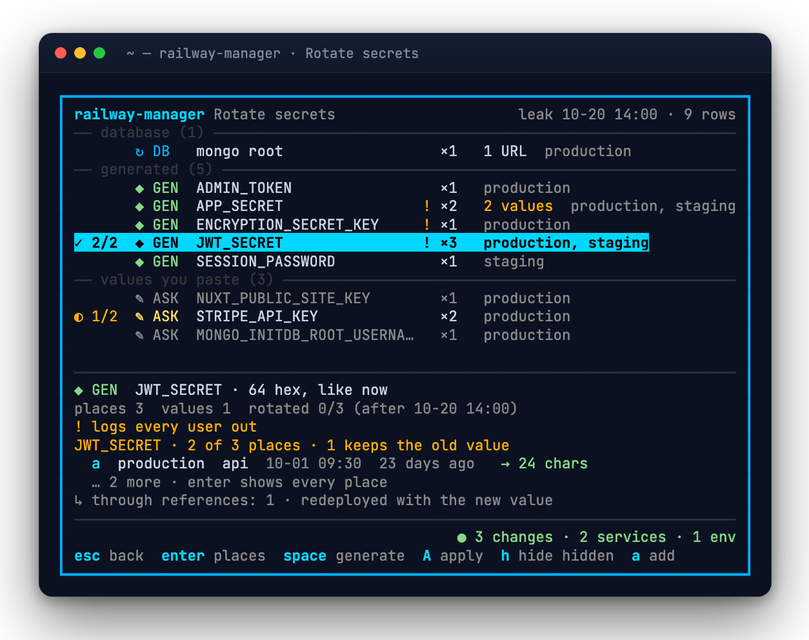

With a leak time set, every value not changed since then is marked as still
exposed. You can generate new values shaped like the old ones, paste the ones
only a vendor can issue, and apply them all in one run. If Railway could not
read some places, Rotate says so above its rows, since a secret there is not
counted.

### Database passwords

For MongoDB, PostgreSQL and Redis the app changes the password in the database
itself. It opens an SSH tunnel through `railway ssh` and runs the database's own
client. Then it rewrites every connection URL that used the password, in every
environment (a `MONGO_SOURCE` in `staging` that points at production included),
redeploys, and logs in with the new password to check it works.

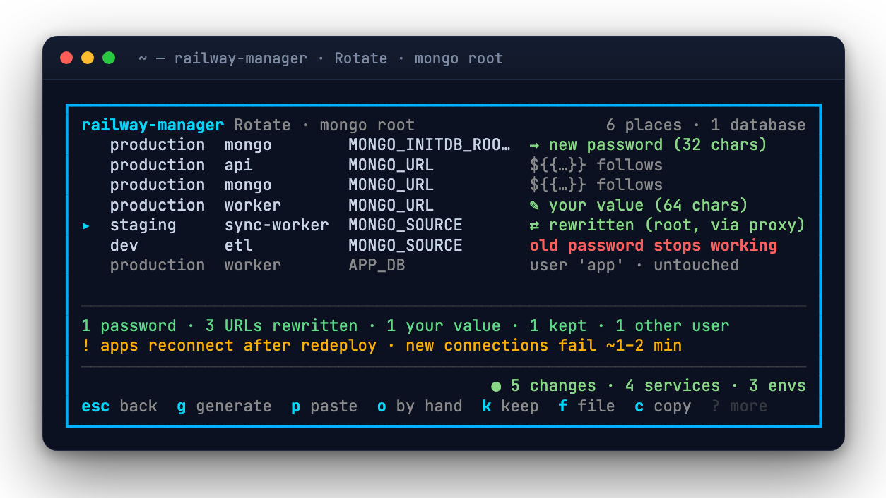

You decide for each place: rewrite the URL, paste your own, keep it, or copy it
from somewhere else. Before you apply, the screen shows which services will
lose their connection.

### Live services

The Services screen shows every project at once: status over a websocket, CPU,
memory and network as live charts, deploys, domains, regions and limits.

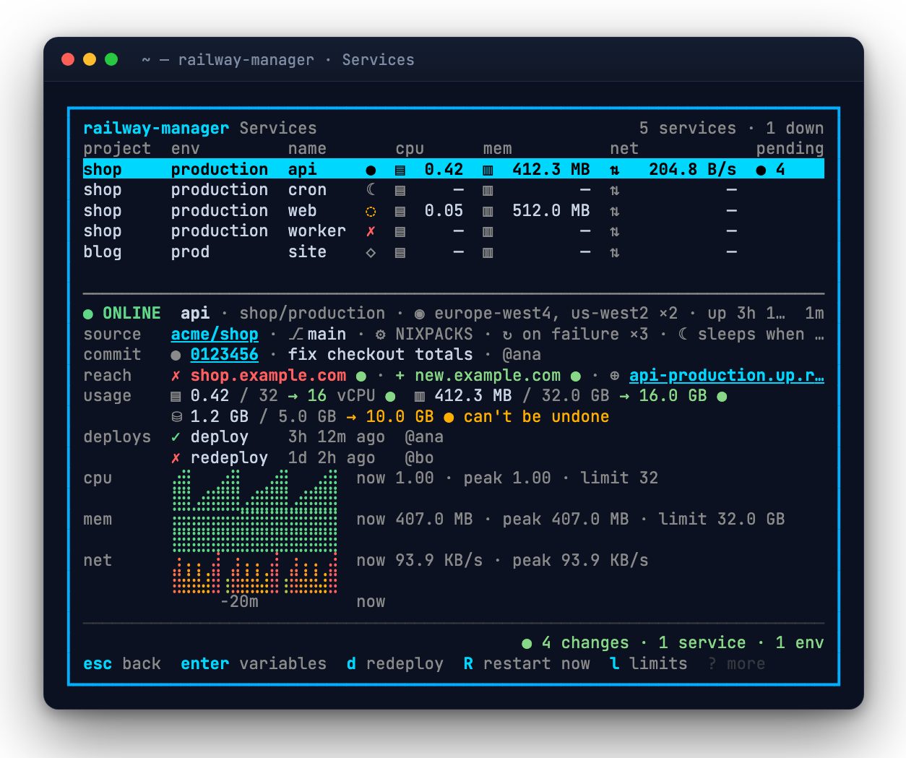

From a service's row you can open its variables, change its vCPU and memory
limits or volume size, add and remove domains, tail its logs, redeploy it or
restart it.

### Variables and history

Variables can be browsed by name or by value: where the same value is shared,
where copies differ, and who changed each one and when. History is one feed of
Railway's change history for all your environments, with this app's own runs
marked so you can open them.

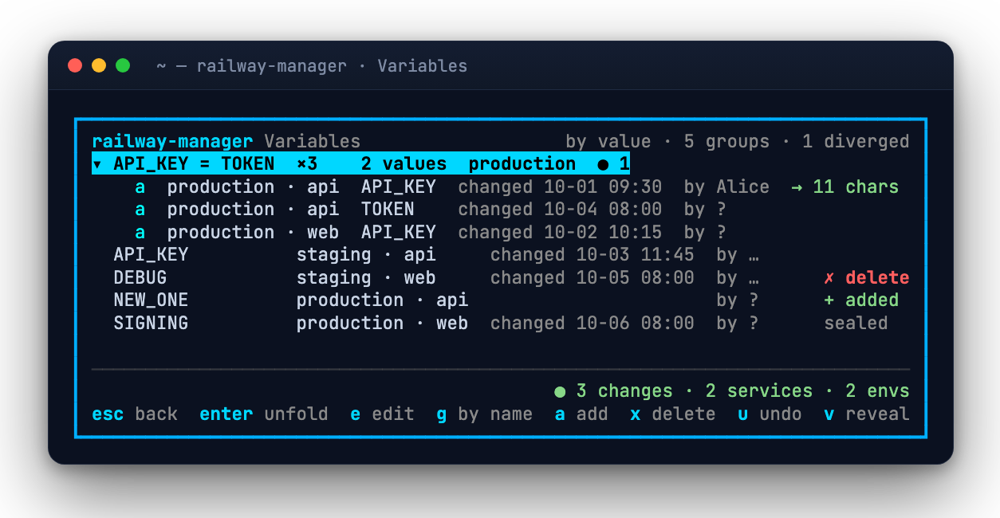
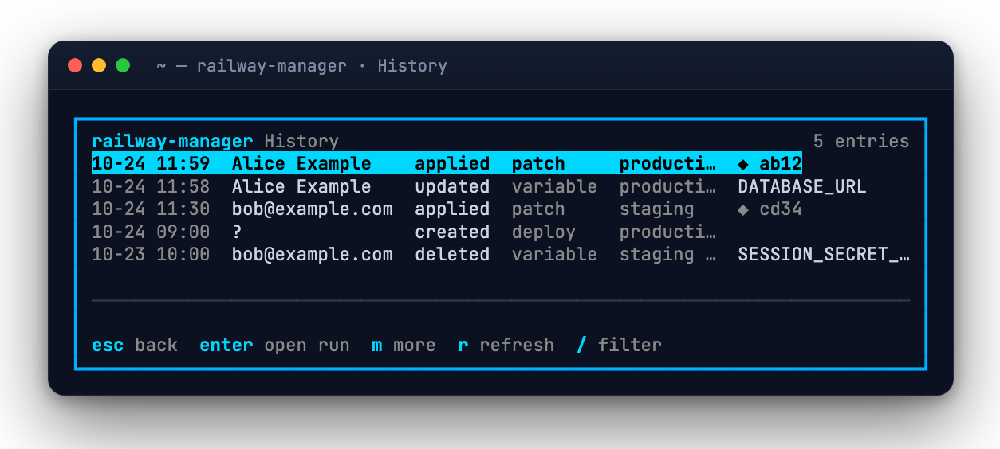

## How secrets are handled

- Values show as `•••• (N chars)`. `v` reveals one value at a time, only on an
  interactive terminal, and hides it again when the cursor moves.
- Secrets never go into a process's arguments, a log, the run journal, an error
  message or a test fixture. Database clients get passwords through the
  environment or stdin, and PostgreSQL gets a SCRAM verifier instead of the
  password.
- Database tunnels listen on a Unix socket in a private directory, so no other
  local user can connect to them. ssh trusts only host keys you confirmed, and
  never forwards your agent.
- The app writes only to the environments you marked writable in Settings.
- Files on disk are `0600` in a `0700` directory. A staged value stays on disk
  until it is applied. A finished run is rewritten without its values, an
  abandoned one keeps only the database password a revert may need, and runs
  are deleted after 30 days. The journal never holds a value.
- On macOS the work directory is excluded from Time Machine and Spotlight. On
  Linux, exclude `~/.railway-manager` from your backup tool yourself.
- Only the `railway` CLI gets the Railway token. No other program the app
  starts sees it.

## Keys

| Where | Keys |
| --- | --- |
| Home | `s` services · `v` variables · `h` history · `R` rotate secrets · `c` change set · `o` settings · `r` refresh · `q` quit |
| Everywhere | `?` more keys · `/` filter · `esc`/`q` back · `↑ ↓ j k PgUp PgDn` move |
| Variables | `e` edit · `a` add · `x` delete · `u` undo · `g` by name / by value · `v` reveal |
| Services | `enter` variables · `l` limits · `z` disk · `m` domains · `t` logs · `d` redeploy · `R` restart now |
| Change set | `space` select · `a` apply · `t` redeploy on/off · `x` remove · `enter` open run |
| Run | `r` resume · `X` abandon · `t` trust the SSH host key |

## Files

Everything lives in `~/.railway-manager/`, or `$RAILWAY_MANAGER_HOME` if set:
your settings, your change set, the SSH host keys you trusted, and one
directory per run with its journal. A run's directory is kept for 30 days after
it finishes or is abandoned. Each user has their own directory, and nothing is
shared through Railway until you apply.

## Develop

```bash
make test         # unit, screen and fake-Railway tests
make test-race    # the same, with the race detector
make lint         # gofmt, go vet, golangci-lint when installed
make shots        # rerender the README screenshots from the screen tests (needs Chrome)
```

Screens are tested as golden frames at 80 and 60 columns, and every frame is
checked for leaked fixture secrets. A fake Railway (HTTP and websocket GraphQL)
and a fake process runner drive whole rotations without a network. The design
and the reasons behind it are in [`docs/design.md`](docs/design.md).

### Live tests

The live tests run against a real Railway environment you choose, and only when
you ask. No target is built in:

```bash
export RM_LIVE_PROJECT=my-sandbox      # project name or id
export RM_LIVE_ENV=dev                 # environment name or id
export RM_LIVE_SERVICE=api             # an app service the tests may change
export RM_LIVE_WORKER=worker           # a second app, for the database tests only
make live                              # read checks, variables, redeploy, restart, limits, domains
make live-db                           # also changes the environment's Redis password, and back
```

The environment must hold the shared variable `RM_LIVE_TEST_TARGET=1`, and the
tests refuse any environment without it. They touch only `RM_TEST_*` variables
and `rm-test-*.example.com` domains, and clean up after themselves. The database
tests use the SSH host keys you trusted in the app.

## License

[MIT](LICENSE)

---

<p align="center">
  <br>
  <sub>railway-manager is an independent tool and is not affiliated with Railway Corp.</sub>
</p>
